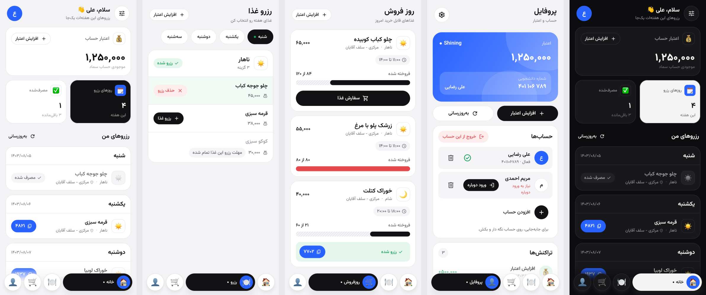
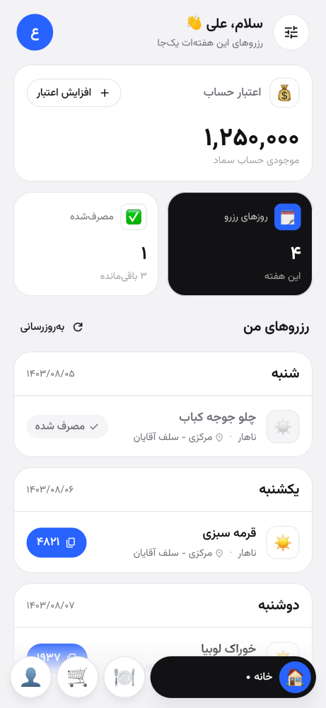
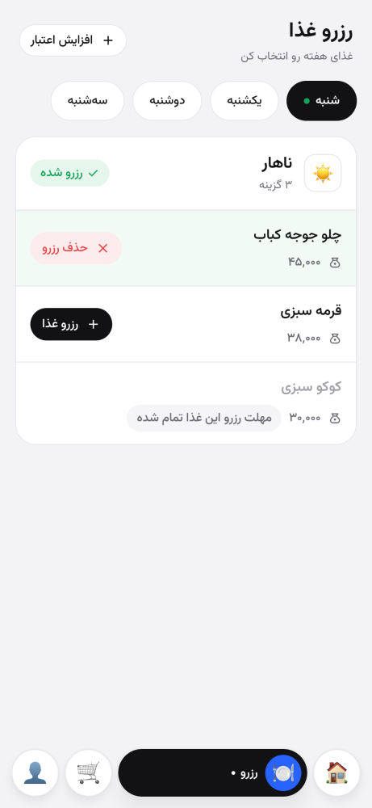
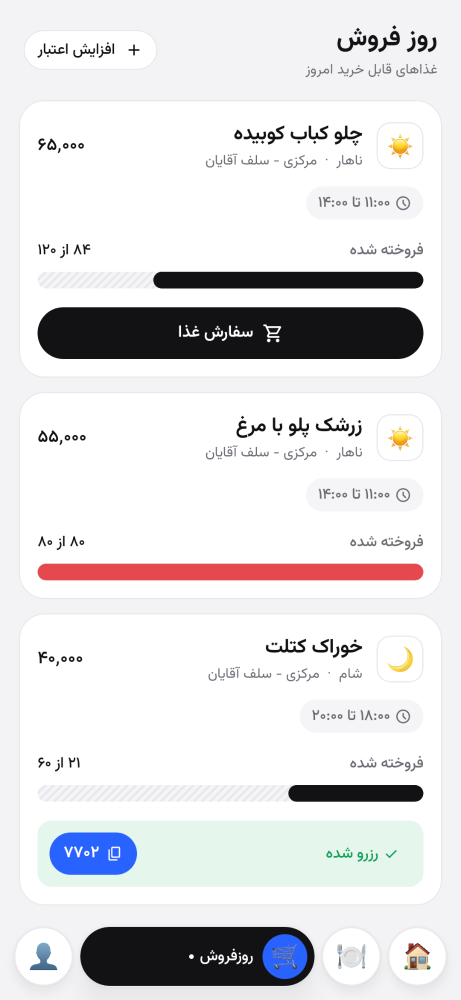
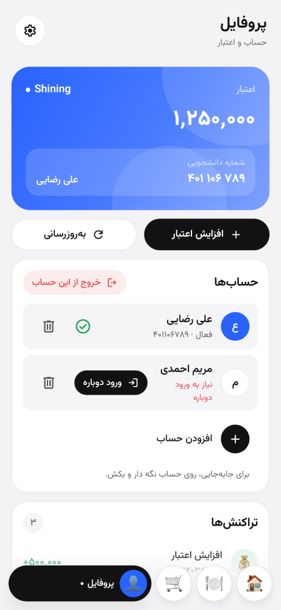
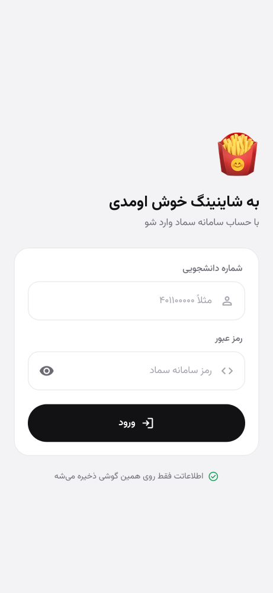
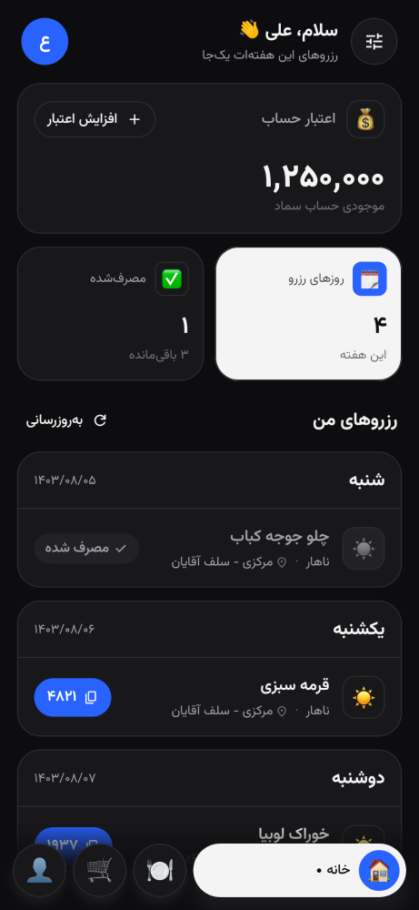
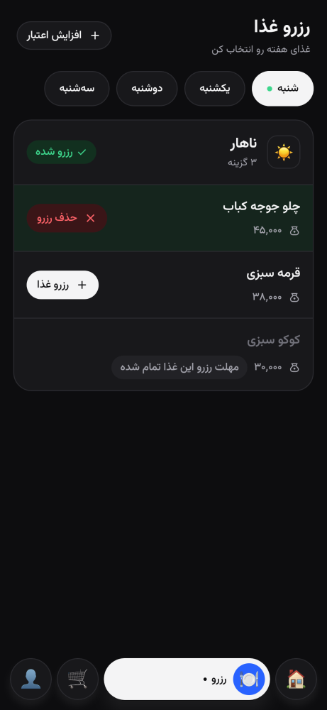

# ☀️ Shining: SUT Food Reservation Client

**Shining** is a standalone client for the Sharif University of Technology (SUT) food reservation system, **Samad**. The app talks to the Samad servers directly. **Your login and reservations stay on your phone.** A Nisatech server watches when next week's menus are published and sends the alert; it never receives anything about you or your account, unless you join the market (below). The server's code is kept in a separate, private repo.

Shining is built on [Foodie](https://github.com/amirHravan/foodie) by Amir Hossein Ravan Nakhjavani, with a redesigned interface.



## ✨ Features

- **Home overview**: your credit, how many days are reserved and eaten, and every reserved meal with its forget code. Fetch a code once and it stays next to the meal, even after restarting the app.
- **Food reservation**: every cafeteria's foods in one list, one day at a time; reserve or cancel with one tap. Days that already have a reservation are marked. Each food shows its cafeteria's capacity from Samad (e.g. کاله «ظرفیت ۶۰۰»), so it's clear which ones fill up; سلف مرکزی's isn't shown. It's a fixed number, not what's left: Samad's menus don't say how many remain.
- **Daily sale**: buy food when the university runs a daily sale, with a live "sold" bar for each item.
- **Profile**: credit, transactions and student details, plus quick switching between up to five Samad accounts (long-press the Profile tab).
- **Market** (بازار): sell the forget code of a meal you reserved and won't eat, or buy someone else's. Each meal has a board of listings and offers; "Buy now" takes the cheapest listing and "Sell now" accepts the highest offer. The buyer pays card-to-card within 5 minutes, the seller confirms, and the code reaches the buyer in the app. A card on Home offers your next meal for sale with its live price. Today's, tomorrow's and next week's meals can all be traded.
- **Next-week menu alerts**: a notification as soon as next week's menu of سلف, کاله, کلانا, کلین‌فود, یونی‌فود or فست‌فود شریف comes out (choose which in Settings); tapping it opens Reserve on that day. سلف gets one alert, once its whole week is open, instead of one per day. A card on Home shows each one's status and when it usually arrives.
- **Reminders**: on Tuesday and Wednesday, only if menus are out and you still have days left to reserve.
- **Light and dark themes**, following the system setting.

### Design

- Light, card-based layout with a floating bottom bar; the current tab grows into a labelled pill.
- Main color `#2862FF` (blue). The logo is the 🍟 French fries from Google's [Noto Emoji](https://github.com/googlefonts/noto-emoji) (3D style, see [`licenses/Noto-Emoji-LICENSE.txt`](licenses/Noto-Emoji-LICENSE.txt)) in `res/drawable-nodpi/logo_fries.png`, on no background, both as the app icon and inside the app. The French fries food picture keeps the Apple emoji.
- Pictures (tabs, meals, cards) are Apple emoji, bundled as PNGs in `res/drawable-nodpi/emoji_*.png`. Action icons (add, refresh, copy, ...) stay as line icons.
- Typeface: [Vazirmatn](https://github.com/rastikerdar/vazirmatn) (SIL Open Font License, see [`licenses/Vazirmatn-OFL.txt`](licenses/Vazirmatn-OFL.txt)).

## 📱 Screens

| Home | Reserve | Daily sale | Profile |
| :---: | :---: | :---: | :---: |
|  |  |  |  |

| Login | Home (dark) | Reserve (dark) | |
| :---: | :---: | :---: | :---: |
|  |  |  | |

The screens show sample data.

## 📲 Install on your phone

1. Build the debug APK (JDK 17 and the Android SDK are needed):
   ```bash
   ./gradlew assembleDebug
   ```
2. Install it with USB debugging enabled:
   ```bash
   adb install app/build/outputs/apk/debug/app-debug.apk
   ```
   Or copy the APK to the phone and open it.

Shining uses its own application id (`app.shining`), so it installs next to Foodie without replacing it. Accounts are not shared between the two; log in again in Shining.

## 🚀 Releases

Signed APKs are on the [Releases](https://github.com/Nisatech-org/shining-app/releases) page. They're built by [`.github/workflows/release.yml`](.github/workflows/release.yml): pushing a tag such as `v1.12.0` (it must match `versionName`) builds the signed release APK and publishes it with its SHA-256 checksum. The release notes are the tagged commit's message body. Running the workflow by hand builds the same APK as a run artifact without publishing it. The signing key and Firebase config come from repository secrets, listed at the top of the workflow.

A release is published from the team's private repo with `PUSH=1 bash deploy/publish-app.sh <notes.md>`: this repo always holds a single commit with the app (the server's code stays private), so each release replaces it with a new one named `Shining <version>`, with the notes as its body, and adds the matching tag, which starts the workflow. Each tag keeps its own commit, so older releases stay intact.

## 🔒 The market and your privacy

The market is opt-in: nothing changes for anyone who never taps "ورود به بازار". To join, the app sends your Samad token to the Shining server **once**; the server reads your student number from Samad and keeps only a keyed hash of it, so the same student always has one market account. For the people who join, the server keeps:

- that hash and a random push topic;
- your listings, offers and trades (meal, price, times, status, your rating);
- if you sell, your card number, encrypted, shown only to the buyer of a trade while they pay.

Names are never shown, but a buyer sees the card holder's name in their own bank app when paying. Forget codes are deleted from the server as soon as the buyer's phone has them. Leaving the market deletes your account and card.

## 🛠️ Architecture & Tech Stack

Shining follows **MVVM**.

- **Jetpack Compose** for the UI, with a small in-house design system in `domain/ui` (theme tokens, cards, buttons, pills, states).
- **Retrofit2** for the Samad API.
- **Koin** for dependency injection.
- **Room** for local storage.
- **Coroutines** for asynchronous work.

## 🤝 Contributing

See [contributing.md](contributing.md).

## 📜 License

Shining is a derivative of Foodie and is distributed under the same custom MIT License with additional restrictions (no commercial use). See [LICENSE](LICENSE).
